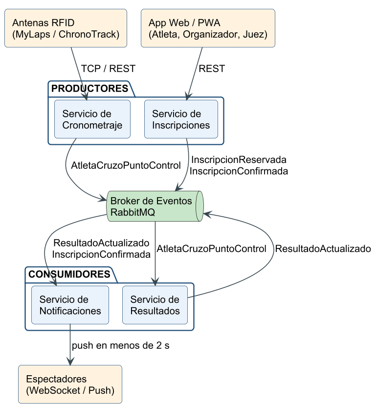

# ActiveTrack · Prueba de Concepto

Plataforma de gestión y cronometraje de eventos deportivos construida con una **Arquitectura Orientada a Eventos (EDA)**
y el patrón de diseño **Observer**. Implementa los dos módulos críticos del caso:

- **Procesamiento de tiempos**: de la lectura de la antena RFID a la notificación del espectador en **menos de 2 segundos**
  (medido: 16 a 37 ms).
- **Inscripciones con alta concurrencia**: reserva atómica del cupo, lista de espera, pago con pasarela sandbox y kit QR.
  Probado con **10 000 inscripciones** sin errores ni sobreventa (ver [pruebas-carga](pruebas-carga/README.md)).



## Arquitectura

| Contenedor | Tecnología | Rol en la EDA | Puerto |
|---|---|---|---|
| `inscripciones-service` | Java 17, Spring Boot 3, Spring Security | **Productor**: eventos, cupos, inscripciones, pagos y login; publica `InscripcionReservada` e `InscripcionConfirmada` | 8084 |
| `cronometraje-service` | Java 17, Spring Boot 3 | **Productor**: recibe lecturas RFID y publica `AtletaCruzoPuntoControl` | 8081 |
| `resultados-service` | Java 17, Spring Boot 3 | **Consumidor/productor**: calcula tiempos, actualiza el leaderboard (Redis) y publica `ResultadoActualizado` | 8082 |
| `notificaciones-service` | Java 17, Spring Boot 3, WebSocket | **Consumidor**: avisa a espectadores (patrón Observer) y envía correos a atletas | 8083 |
| `frontend` | HTML, CSS, JavaScript (Nginx) | En vivo, seguimiento, inscripciones, panel del juez, panel del organizador y simulador RFID | 8080 |
| `rabbitmq` | RabbitMQ 3.13 | Broker de eventos (colas durables + DLQ) | 5672 / 15672 |
| `postgres` | PostgreSQL 16 | Datos transaccionales | 5432 |
| `redis` | Redis 7 | Contador de cupos y leaderboard | 6379 |

Flujo de un cruce:

```
Antena RFID ──POST /api/lecturas──▶ Cronometraje ──AtletaCruzoPuntoControl──▶ RabbitMQ
                    ◀── 202 Accepted (no espera cálculos)                          │
                                                                                     ▼
Espectador ◀──WebSocket── Notificaciones ◀──ResultadoActualizado── RabbitMQ ◀── Resultados ──▶ Redis
              (Observer)                                                         (tiempos, disputas)
```

Flujo de una inscripción:

```
Atleta ──POST /api/inscripciones──▶ Inscripciones ──DECR cupos:{categoría}──▶ Redis (atómico)
          ◀── 202 PENDIENTE_PAGO (10 min) o EN_ESPERA                │
Pasarela ──webhook APROBADO──▶ Inscripciones ──InscripcionConfirmada──▶ RabbitMQ ──▶ Notificaciones ──▶ correo con el kit
```

Si la reserva vence sin pago, un proceso programado libera el cupo y se lo asigna al primero de la lista de espera.

### Patrón Observer (`notificaciones-service`, paquete `observer`)

| Rol GoF | Clase |
|---|---|
| Subject | `AtletaSeguido` |
| Observer | `SeguidorAtleta` (interfaz) |
| ConcreteObserver | `WebSocketSeguidor`, `PushSeguidor` |
| Client | `ResultadoEventListener` |

### Seguridad

`POST /api/auth/login` valida la clave (BCrypt) y emite un **JWT** con el rol. Todos los servicios validan el token con
la misma clave (`JWT_SECRET`):

| Rol | Puede |
|---|---|
| `ORGANIZADOR` | Crear eventos, cambiar cupos y tarifas, ver inscritos, reembolsar, exportar CSV, reiniciar la demo |
| `JUEZ` | Ver anomalías y aplicar DSQ, penalidades o "sin sanción" |
| Público | Catálogo, inscripción, pago, kit, leaderboard, seguimiento, historial y envío de lecturas RFID |

Usuarios de demostración (creados por `db/init.sql`): `organizador` / `organizador123` y `juez` / `juez123`.

## Estructura del repositorio

```
activetrack/
├── common-events/            Contratos de eventos compartidos (records Java)
├── inscripciones-service/    controller · service · model · repository · messaging · config
├── cronometraje-service/     controller · service · model · repository · messaging · config
├── resultados-service/       controller · service · model · repository · messaging · config
├── notificaciones-service/   controller · service · observer · messaging · config
├── frontend/                 index.html · app.js · inscripciones.js · organizador.js · pasarela.html · nginx.conf
├── db/init.sql               Esquema y datos semilla (2 eventos, 12 atletas ficticios, usuarios de demo)
├── pruebas-carga/            Prueba de carga k6 de la apertura de inscripciones y sus resultados
├── docs/                     Informe, backlog Scrum y diagramas (PlantUML + PNG)
├── scripts/                  Backlog (JSON) y script que crea el tablero en GitHub Projects
├── .github/workflows/ci.yml  Pruebas automáticas en GitHub Actions
├── Dockerfile                Imagen de los servicios (se elige el módulo con MODULE)
└── docker-compose.yml
```

## Cómo ejecutarlo

Requisito: **Docker Desktop**.

```bash
docker compose up --build
```

Luego abrir **http://localhost:8080**.

**Cronometraje en vivo (evento 1, maratón en curso)**

1. **Seguir atletas**: seguir a uno o más atletas (por ejemplo, el dorsal 107).
2. **Simulador RFID**: *Iniciar carrera*. El simulador reemplaza al hardware y envía las lecturas.
3. **En vivo**: el leaderboard se reordena solo y muestra la latencia de cada actualización.
4. **Juez** (iniciar sesión como juez): aparece la anomalía del dorsal 107 (omitió el control 10K); aplicar *Sin sanción*, *+5 min* o *DSQ*.

**Inscripciones (evento 2, inscripciones abiertas)**

1. **Inscripciones**: elegir la carrera 10K, completar el formulario e inscribirse. La categoría *Damas 40+* tiene solo 3 cupos para probar la lista de espera.
2. *Pagar ahora* abre la pasarela sandbox; al aprobar, la inscripción se confirma con dorsal y chip.
3. *Mis inscripciones*: consultar con el documento y ver el **kit QR**. Los correos simulados aparecen al final de la página.
4. **Organizador** (iniciar sesión como organizador): cupos por categoría, tarifas, inscritos, reembolsos, exportación CSV y creación de eventos.

Consola de RabbitMQ: http://localhost:15672 (usuario y clave `guest`).

## Pruebas

- **Unitarias** (JUnit 5 + Mockito, 48 pruebas), no necesitan Docker: `./mvnw test` (en Windows `mvnw.cmd test`).
- **CI**: cada push a `main` ejecuta las pruebas y construye las imágenes en GitHub Actions.
- **Carga** (k6): 10 000 inscripciones concurrentes, ver [pruebas-carga/README.md](pruebas-carga/README.md).

## Scrum

- Backlog con 23 historias de usuario (RF y RNF) organizadas en sprints: [docs/backlog.md](docs/backlog.md).
- Para crearlas como issues en un **GitHub Project** (con milestones por sprint y las historias terminadas cerradas):

```bash
node scripts/crear-backlog-github.mjs
```

## Documentación

- Informe del proyecto (Modelo 4+1, C4, ADRs, patrón Observer): [docs/informe/Informe_ActiveTrack_Arquitectura.docx](docs/informe/Informe_ActiveTrack_Arquitectura.docx)
- Diagramas fuente en PlantUML: [docs/](docs/)

## API principal

| Método | Ruta | Servicio | Rol | Descripción |
|---|---|---|---|---|
| POST | `/api/auth/login` | Inscripciones | — | `{usuario, clave}` → JWT |
| GET | `/api/catalogo/eventos` | Inscripciones | — | Eventos abiertos con tarifa vigente y cupos |
| POST | `/api/inscripciones` | Inscripciones | — | Reserva el cupo → 202 `PENDIENTE_PAGO` o `EN_ESPERA` |
| GET | `/api/inscripciones?documento=` | Inscripciones | — | Inscripciones del atleta |
| POST | `/api/inscripciones/{id}/pago?documento=` | Inscripciones | — | Inicia el cobro → URL de la pasarela |
| GET | `/api/inscripciones/{id}/qr.png?documento=` | Inscripciones | — | Kit digital (QR) |
| POST | `/api/pagos/webhook` | Inscripciones | — | Notificación de la pasarela `{referencia, estado}` |
| POST | `/api/admin/eventos` | Inscripciones | ORGANIZADOR | Crea evento con ruta, puntos, categorías y tarifas |
| GET | `/api/admin/eventos/{id}` | Inscripciones | ORGANIZADOR | Cupos, confirmados, pendientes y lista de espera |
| PUT | `/api/admin/categorias/{id}/cupo` | Inscripciones | ORGANIZADOR | Cambia el cupo (promueve la lista de espera) |
| POST | `/api/admin/eventos/{id}/tarifas` | Inscripciones | ORGANIZADOR | Agrega una tarifa por vigencia |
| POST | `/api/admin/inscripciones/{id}/reembolso` | Inscripciones | ORGANIZADOR | Reembolsa y libera el cupo |
| GET | `/api/admin/eventos/{id}/inscritos.csv` | Inscripciones | ORGANIZADOR | Exporta inscritos |
| POST | `/api/lecturas` | Cronometraje | — | Lectura RFID `{chipId, antenaId, marcaTiempo?}` → 202 |
| GET | `/api/antenas?eventoId=1` | Cronometraje | — | Estado y última señal de cada antena |
| GET | `/api/eventos/{id}/leaderboard?categoriaId=` | Resultados | — | Leaderboard desde Redis |
| GET | `/api/resultados/atletas/{documento}/historial` | Resultados | — | Historial, posiciones y ritmo del atleta |
| GET | `/api/eventos/{id}/anomalias` | Resultados | JUEZ | Atletas con puntos de control omitidos |
| POST | `/api/resultados/{inscripcionId}/penalizaciones` | Resultados | JUEZ | `{tipo: TIEMPO\|DSQ\|SIN_SANCION, segundos, motivo, juez}` |
| GET | `/api/eventos/{id}/resultados.csv` | Resultados | ORGANIZADOR | Exporta resultados |
| WS | `/ws/seguimiento` | Notificaciones | — | `{"accion":"seguir","atletaId":7}` · `{"accion":"leaderboard"}` |
| POST | `/api/seguimientos/push` | Notificaciones | — | Suscribe un token push a un atleta |
| GET | `/api/correos` | Notificaciones | — | Últimos correos enviados (simulados) |

## Despliegue en la nube (AWS)

Cada servicio es una imagen Docker independiente, por lo que se despliega igual en AWS ECS (Fargate) detrás de un
Application Load Balancer, con Amazon MQ (RabbitMQ), Amazon RDS (PostgreSQL) y ElastiCache (Redis). Solo cambian
las variables de entorno `DB_URL`, `DB_USER`, `DB_PASSWORD`, `RABBIT_HOST`, `RABBIT_USER`, `RABBIT_PASSWORD`,
`REDIS_HOST` y `JWT_SECRET`.
